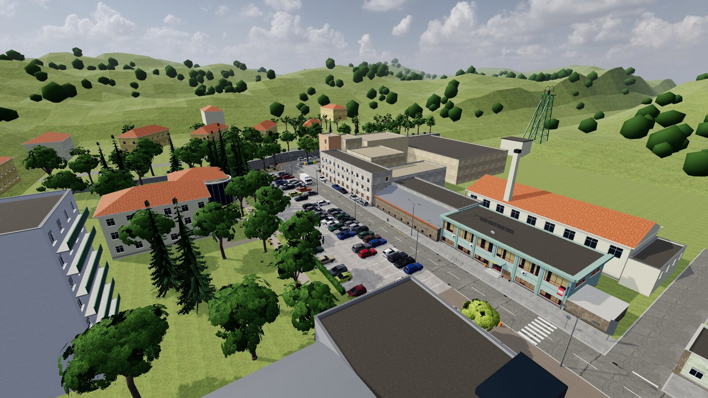
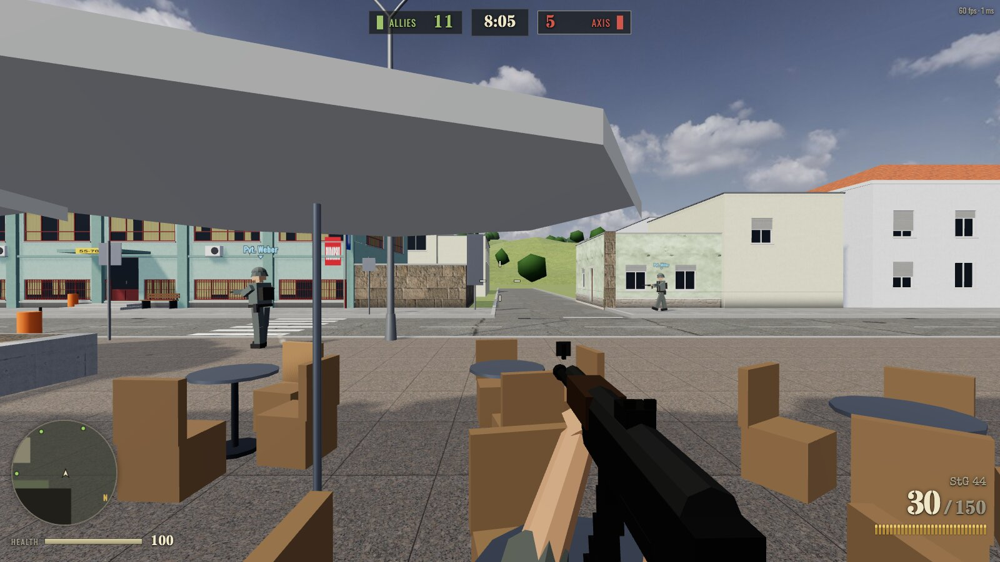
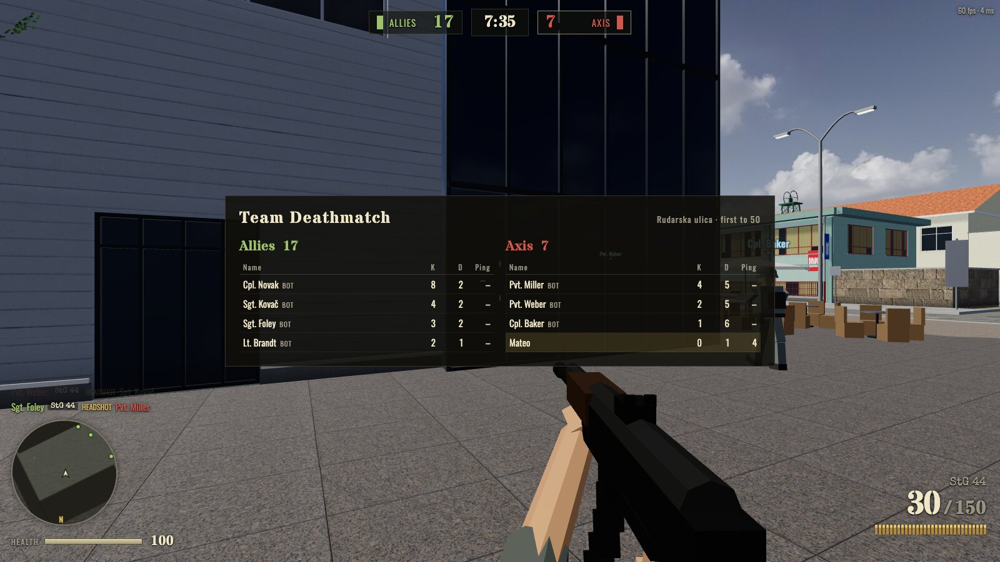
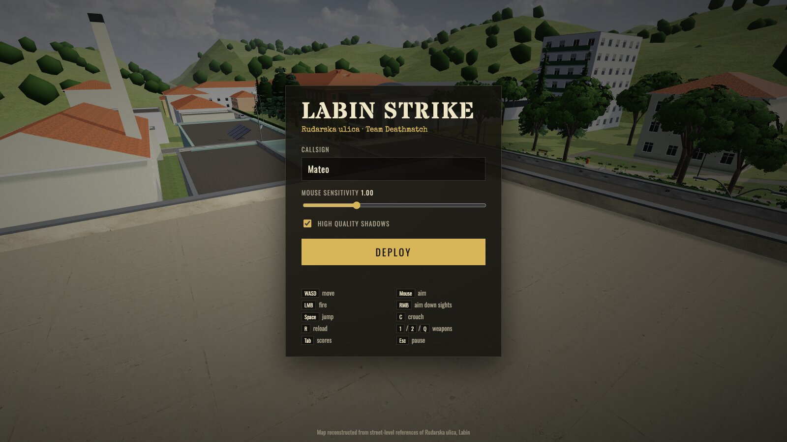

# Labin Strike

A browser-based, low-poly multiplayer team deathmatch shooter set on **Rudarska ulica in Labin, Croatia**. The map is rebuilt from street-level references, and the gunplay is old-school: hitscan rifles, health that regenerates, and bots that fill empty slots.



<table>
  <tr>
    <td width="50%"></td>
    <td width="50%"></td>
  </tr>
  <tr>
    <td width="50%"></td>
    <td width="50%" valign="top">

**Allies vs Axis.** First team to 50 kills, or the leading team when the 10-minute timer runs out.

- 22 WWII weapons across six classes (Rifleman, Assault, Support, Marksman, Officer, Engineer), each with its own damage falloff, fire rate, recoil, spread, reload style, handling and movement weight
- Strict faction rules: Axis soldiers only ever carry Axis weapons and Allied soldiers Allied ones, enforced by the server
- Aim down sights, sprint, crouch, jump, and spawn protection
- Every soldier, on either side, carries one Stielhandgranate 24 stick grenade per life. It bounces off the map, has a 3.5 s fuse, and bots throw theirs at enemies who duck behind cover
- A knife on <kbd>V</kbd> (M3 trench knife or S84/98 bayonet): one stab kills at arm's length. Bots use it up close, and they move in for it while reloading
- Every death, friendly or enemy, leaves an ammo can under the body for 30 s. Walk over it to refill your own weapons' reserve, up to what you spawned with
- Health regenerates COD2-style after 5 s without taking damage
- Server-side bots fill the match up to 8 players. They use A* pathfinding, line-of-sight targeting and human-like aim error
- Killfeed, compass/minimap, hitmarkers, damage direction indicators

</td>
  </tr>
</table>

## Quick start

Requires **Node.js 20+**.

```bash
npm install
npm run dev          # http://localhost:7344
```

In dev, the Node server runs the game simulation and serves the client through Vite middleware, all on one port. Open the URL, pick a callsign (and optionally a side) and hit **Deploy**, then choose a class and weapons on the loadout screen. Open a second tab to play against yourself, or let the bots handle it.

Handy URL params: `?name=Mateo` pre-fills the callsign, `?team=axis` picks a side, `?cls=support&primary=mg42&secondary=luger` preselects a loadout, and `?autojoin` deploys as soon as the map loads.

### Controls

| Key | Action | Key | Action |
| --- | --- | --- | --- |
| <kbd>W</kbd><kbd>A</kbd><kbd>S</kbd><kbd>D</kbd> | Move | Mouse | Aim |
| <kbd>LMB</kbd> | Fire | <kbd>RMB</kbd> | Aim down sights |
| <kbd>Shift</kbd> | Sprint (forward) | <kbd>G</kbd> | Throw grenade |
| <kbd>Space</kbd> | Jump | <kbd>C</kbd> / <kbd>Ctrl</kbd> | Crouch |
| <kbd>R</kbd> | Reload | <kbd>1</kbd> / <kbd>2</kbd> / <kbd>Q</kbd> | Rifle / pistol / last weapon |
| <kbd>Tab</kbd> | Scoreboard | <kbd>Esc</kbd> | Pause |
| <kbd>V</kbd> | Knife | <kbd>B</kbd> | Loadout / switch side |

## How it works

```
client/   three.js renderer, input, HUD, viewmodel, audio, prediction   (Vite)
server/   authoritative TDM simulation, bots, nav grid, HTTP + signaling
shared/   constants, Rapier physics + character motor, hitboxes, map parsing
tools/    Blender build scripts for the map and cars, texture/sky generators
```

- **Networking.** [geckos.io](https://github.com/geckos-io/geckos.io) sends data over WebRTC data channels, so it behaves like UDP inside the browser. The server ticks at 30 Hz and sends snapshots at 20 Hz. Clients upload input at 30 Hz and interpolate remote players with a 110 ms buffer. HTTP and the WebRTC UDP mux share port **7344**, so one TCP+UDP firewall rule is enough.
- **Physics.** [Rapier](https://rapier.rs/) runs the same kinematic character motor on both sides: the client for the local player, the server for bots. Movement collides identically everywhere.
- **Grenades.** `shared/grenade.js` steps the flight (gravity, bounces off solid geometry) at a fixed 60 Hz. The server runs it to place the blast and deal damage: full damage within 2 m, nothing past 7.5 m, only to body parts it can see, never to teammates, but to the thrower. Clients replay the same throw so their visual follows the server's path until the `boom` message arrives.
- **Knife and ammo cans.** The client picks who its stab reaches, and the server re-checks reach, angle and line of sight with some slack for latency (`knifeReach` in `shared/hitbox.js`). The server also places the ammo cans, gives each one to the first soldier over it who is short of ammunition, and removes them when they expire. Clients only draw them.
- **Hits.** Players have a head sphere plus body and leg capsules, defined in `shared/hitbox.js`. The client claims a hit, and the server checks the shooter's position, the target's position and line of sight before applying damage.
- **Map.** Colliders, spawns and car markers are stored as named nodes inside `parking_lot.glb`. Server and client both read them with `shared/mapdata.js`. The server bakes a 0.5 m walkability grid from the map at startup to give bots their pathfinding.
- **Cars.** Parked cars are instanced from `cars.glb`. Each model costs three draw calls per LOD (paint, opaque, glass), however many copies are on the map.

Match rules and movement live in [`shared/constants.js`](shared/constants.js); weapons, classes and faction rules in [`shared/weapons.js`](shared/weapons.js).

## Weapons and loadouts

| Class | Axis primary | Allied primary | Kit |
| --- | --- | --- | --- |
| Rifleman | Kar98k, Gewehr 43 | M1 Garand, Lee-Enfield No. 4 | +25% reserve |
| Assault | MP 40, StG 44 | M1 Thompson, Sten Mk II | |
| Support | MG 42, FG 42 | BAR M1918A2, Bren Mk I, Browning M1919A6 | +50% reserve |
| Marksman | Kar98k Zf. 39, Kar98k | M1903A4, M1903 Springfield | 4x / 2.5x scopes |
| Officer | MP 40, Gewehr 43 | M1 Thompson, M1 Carbine | double pistol reserve |
| Engineer | Kar98k, MP 40 | M1 Carbine, M3 Grease Gun | +25% reserve |

Sidearms: Walther P38 and Luger P08 (Axis), M1911 and Webley Mk VI (Allies).

- **Data-driven.** Every stat (damage and falloff, rpm, magazine and reserve, reload style and timing, hip/ADS/movement spread, bloom, recoil, ADS time and zoom, draw time, movement weight, muzzle velocity, sound and muzzle flash) is a field in `shared/weapons.js`. To add a weapon, add an entry, list it under a class, and optionally give it a model in `client/src/gunmodels.js`.
- **Reload styles.** Detachable magazines, the M1 Garand's en-bloc clip (with the ping when it empties), stripper-clip chargers for bolt-actions (time depends on rounds missing), single-round loading for the scoped rifles, belt reloads for the MG 42 and M1919, and a break-top speed-loader for the Webley. Bolt-actions also work the bolt between shots.
- **Server-authoritative.** The server stores each player's loadout and per-life ammunition. Loadout requests are validated against the player's server-side team and class lists, `fire` is only accepted for the two weapons issued for the current life while rounds remain, and spawning re-checks the loadout. Switching sides (B → Switch) converts the loadout to the other faction's equivalent, is refused when it would stack the humans, and is rate-limited. A class change applies at once within 5 s of spawning if you have not fired or been hit yet, otherwise at the next spawn. Bots roll a random class from their own faction every life.
- The grenade is equipment rather than a loadout weapon: every class on both sides gets `GRENADE.count` per life, so the faction rules do not apply to it. The server only accepts a throw from a living player with a grenade left, from near their own eye position. There are no weapon pickups; any future equip path should go through `canUse()` / `isValidLoadout()` in `shared/weapons.js`.

## Tests

```bash
npm test             # weapon catalogue, faction rules, grenades, and the server's loadout / fire / team / movement validation
```

## Production

```bash
npm run build        # builds the client into dist/
npm start            # NODE_ENV=production, serves dist/ + game on :7344
```

`server.sh {start|stop|restart|status}` runs the server as a detached background process with a pid file and `server.log`. `GET /healthz` returns server stats as JSON.

`deploy.sh` builds locally, rsyncs to a VPS, runs `npm ci --omit=dev` only when the lockfile changed, and restarts the server. Set the target in a gitignored `.deploy.env`:

```bash
DEPLOY_HOST=user@example.com
DEPLOY_DIR=/srv/labin-strike
```

Environment variables: `PORT` (default `7344`), `UDP_PORT_MIN` / `UDP_PORT_MAX` (default: same as `PORT`).

## Rebuilding assets

The map and cars are generated procedurally in Blender. Their output is committed, so you only need these steps to change the art.

```bash
# Map → client/public/assets/maps/parking_lot.glb
/Applications/Blender.app/Contents/MacOS/Blender -b --factory-startup --python tools/blender/rudarska/build.py

# Procedural decals / foliage cards / resized PBR textures (needs Pillow + numpy)
python3 tools/blender/gen_textures.py

# Sky backdrop grading → client/public/assets/sky/sky.jpg
python3 tools/sky_src/grade_sky.py
```

The car models are built with `tools/blender/cars/` and exported to `client/public/assets/cars/cars.glb` by `export.py`.

`node tools/test/run_straight.mjs` is a movement check. It runs the character motor across the map in straight lines and reports places where you would snag on open ground.

## License

[MIT](LICENSE) © Mateo Hrastnik
